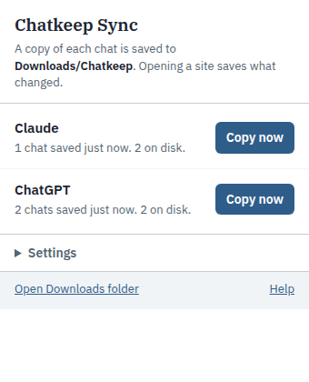

# Chatkeep Sync

A browser extension that keeps a local copy of your Claude and ChatGPT chats, as plain Markdown files, without you doing anything beyond opening the site.

Your chats live on the service's servers, so the same account shows the same conversations in the desktop app, on your phone and in a browser tab. Chatkeep Sync uses that: each time you open claude.ai or chatgpt.com in your browser, it fetches whatever is new or changed since the last copy (including chats you had in the desktop app) and saves each one to a folder in Downloads. Open the tab at the end of the day and the copy is up to date.

Nothing leaves your computer. The extension makes the same requests the site makes for itself, with the session you are already signed in with, and writes files to your disk. It has no server, no analytics and no network access beyond the two chat sites.



## Install (Chrome, Edge, Brave)

The extension is not in a store; you load it from this folder.

1. Download this repository: **Code → Download ZIP**, then unzip it somewhere permanent (for example `Documents\chatkeep-sync`). The browser loads the files from there, so don't delete the folder later.
2. Open `chrome://extensions` (Edge: `edge://extensions`).
3. Turn on **Developer mode** (top right).
4. Click **Load unpacked** and pick the unzipped folder (the one containing `manifest.json`).
5. Pin the icon from the puzzle-piece menu if you want to see its status.

That is all. Open claude.ai or chatgpt.com, signed in as usual, and the first copy starts. The icon shows how many chats are left; the popup shows what happened.

Git users: `git clone https://github.com/lnr-7/chatkeep-sync.git` and load that folder; `git pull` to update.

## What you get

Files land in `Downloads/Chatkeep/<service>/`, one per chat, named by the day the chat started and its title:

```
Downloads/
  Chatkeep/
    claude/
      2026-11-03-plan-a-goa-trip.md
      2026-11-06-fix-my-resume.md
    chatgpt/
      2026-10-29-write-a-haiku-about-rain.md
```

Each file is readable Markdown with the title, a link back to the chat, dates, and one section per message:

```markdown
# Fix my resume

Source: Claude
Link: https://claude.ai/chat/…
Started: 2026-10-30T10:00:00.000Z
Last message: 2026-10-30T10:20:00.000Z

## You (2026-10-30T10:00:00.000Z)

Can you tighten this summary?

## Claude (2026-10-30T10:01:00.000Z)

Here is a tighter version: …
```

When a chat gets new messages, the same file is rewritten. Files do not pile up in the browser's download list; they are removed from that list once saved (they stay on disk).

Settings in the popup: the folder name inside Downloads, whether to copy automatically when you open a site and how often at most (default: at most every 10 minutes), and whether to also save each chat as JSON (the raw messages, for other tools).

### Keeping it somewhere safer than Downloads

The folder is a normal folder. Point OneDrive, Google Drive, Dropbox or a backup tool at `Downloads\Chatkeep`, or move the whole Downloads location in the browser's settings (Settings → Downloads → Location) to a folder that is already synced. Then the copy exists on another device too.

## How it works

| File | Role |
|---|---|
| `manifest.json` | Extension manifest (Manifest V3). Permissions: `storage`, `downloads`, and the two chat sites. |
| `adapters/claude.js`, `adapters/chatgpt.js` | One adapter per service: list chats, fetch one chat, turn it into a common shape. |
| `adapters/shared.js` | Fetch and text helpers the adapters share. |
| `content.js` | Runs on the chat site. Answers the background's requests through the site's own session and announces when the page has loaded. |
| `background.js` | Decides whether a copy is due, works out which chats changed (by their last-updated time), renders Markdown, saves files with the downloads API, keeps the record of what was saved. |
| `markdown.js` | Markdown rendering and file naming. Same layout as [Chatkeep](https://github.com/lnr-7/chatkeep)'s export. |
| `popup.*` | The toolbar popup: status per service, Copy now, settings. |
| `tests/` | `node --test` suite over the adapters and the Markdown module, with fixture files shaped like the sites' responses. |

A copy fetches the chat list once and then only the chats whose last-updated time differs from what was saved before, one at a time with a short pause between requests. It does not poll in the background; it runs when you open the site (or press Copy now, which opens the site for you if needed).

## Limits, honestly

- **Claude and ChatGPT only, for now.** Gemini keeps no chat list the browser can read; use Google Takeout and [Chatkeep](https://github.com/lnr-7/chatkeep) for it. Adding a service means writing one adapter with `list()` and `get(id)`; see `adapters/claude.js`.
- **Uses the sites' internal endpoints.** They are the ones the pages themselves call, not a public API, so a redesign of either site can break the extension until it is updated. The popup will show the error.
- **Text only.** Images and uploaded files are noted as `[image]` or `[attached: name]`, not saved.
- **Chrome's "Ask where to save each file" setting** would prompt for every chat. Keep it off, or expect prompts.
- **Not a sync in the other direction.** It copies from the service to your disk; it never changes anything on the service.
- Firefox is not supported yet (different extension background model).

## Run the tests

```sh
git clone https://github.com/lnr-7/chatkeep-sync.git
cd chatkeep-sync
node --test
```

## License

MIT for the code (see `LICENSE`). IBM Plex fonts are under the SIL Open Font License 1.1.
